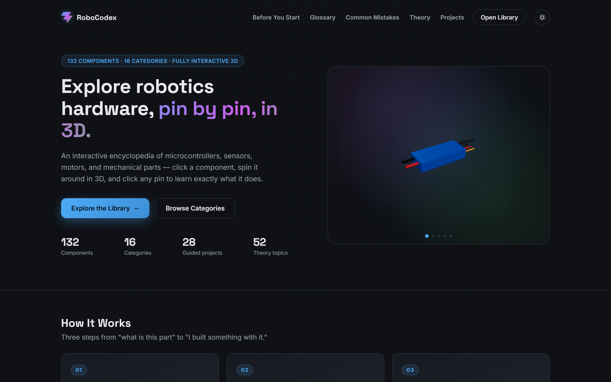
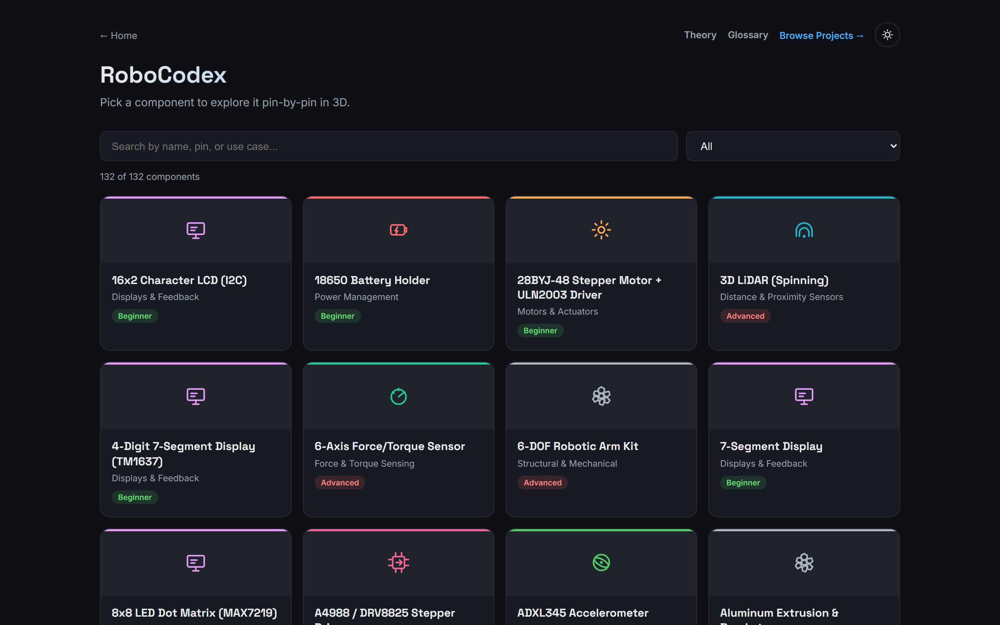
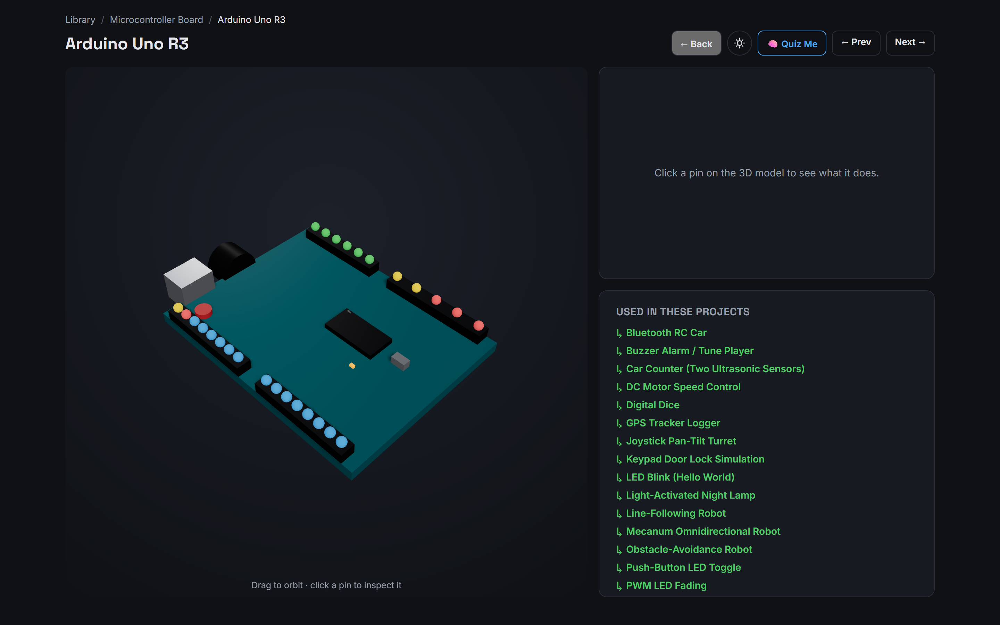

<h1 align="center">🤖 RoboCodex</h1>

<p align="center"><b>Click a part, spin its 3D model, tap any pin — and learn what it really does.</b><br>
132 hand-modelled components · 28 guided builds in 3D · 52 robotics theory topics.</p>

<p align="center">
  <a href="https://www.abasheshranabhat.com.np/Robo_Codex"><b>🌐 Live demo</b></a>
</p>

<p align="center">
  
  
  
</p>

<p align="center"></p>

## Why

Pinout diagrams tell you *which* pin is which, not what it *is*: is it 5 V tolerant, and why does
GPIO2 break your first ESP32 project? Datasheets bury it, and textbooks assume a course you haven't
taken. RoboCodex links **part → build → theory** in one place.

## What's inside

| | |
|---|---|
| 🔩 **Component encyclopedia** | 132 parts, from Arduino-level up to industrial (LiDAR, F/T sensors, CAN, FOC drives). Each has a hand-built 3D model, clickable pins with limits and gotchas, a specs table, use cases, a pin quiz and "confused with / upgrade to" links. |
| 🛠️ **Project library** | 28 builds from LED blink to a mecanum robot, in 4 tiers. Each has a circuit diagram, wiring checklist, explained code, troubleshooting, and a **3D/2D assembled view** with an exploded mode. |
| 📐 **Theory** | 52 topics (control, kinematics, estimation, planning, AI), each with equations in plain words and animated diagrams. |
| 🧭 **Learning aids** | Glossary tooltips, Common Mistakes hub, full-text search, dark/light theme, "mark as built" progress. |

<table>
  <tr>
    <td width="50%"><br><sub><b>Library</b> — browse by category</sub></td>
    <td width="50%"><br><sub><b>Workspace</b> — 3D model, pins, specs</sub></td>
  </tr>
</table>

## Quick start

```bash
cd app             # the npm project lives in app/
npm install
npm run dev        # http://localhost:5173
```

Full setup, build and lint steps: [`app/README.md`](app/README.md#getting-started).

## Status & known issues

| Area | Status |
|---|---|
| Encyclopedia, projects, theory, glossary, search | ✅ Complete |
| 3D/2D assembly views | ✅ All 28 projects. 5 vehicle builds hand-arranged, the rest auto-arranged. |
| Industrial-tier parts used in projects | ⏳ The 33 newest parts are encyclopedia-only |
| SEO / link previews | ⏳ Client-side SPA with no per-page previews or `og:image` |
| Tests and content validation | ⏳ None yet; a malformed JSON entry renders blank fields |
| Licence | ⚠️ No `LICENSE` file, so all rights are reserved by default |

<details>
<summary><b>Technical challenges</b></summary>

- **Scale mismatch.** Each model was built at its own scale, so the first assembled builds showed
  motors bigger than the chassis and parts floating in mid-air. A real-millimetre normalisation table
  plus a shared ground plane fixed it.
- **No external assets.** All 132 models are built from primitives. Consistency (board surfaces, pin
  sizes) is kept by hand, not by a shared base asset.
- **Fuzzy cross-links.** "Paired with / confused with" links come from name matching. They're mostly
  right, not perfect.
- **Backend-free by choice.** Free hosting and fast loads, but changing content means a redeploy, and
  progress doesn't sync across devices.
</details>

## Roadmap

- [ ] Advanced projects using the industrial-tier parts
- [ ] Interactive theory (live PID tuning, IK dragger, A* grid)
- [ ] Per-model code-splitting, prerendered pages, Zod schema + CI tests
- [ ] Side-by-side component comparison; printable cheat sheets
